# Andrea Pullen

**Full-stack TypeScript developer**

I build web apps with React, Next.js, Node.js, and PostgreSQL. I’m especially interested in AI features you can verify. The model drafts, tested code checks the output, and a person approves what goes out.

[Portfolio repository](https://github.com/apullenb/My-Portfolio) · [LinkedIn](https://www.linkedin.com/in/andrea-pullen/)

## GitHub activity

## Pac-Man contribution map

Pac-Man plays through my GitHub activity. Each square represents a day of contributions.

<picture>
  <source media="(prefers-color-scheme: dark)" srcset="https://raw.githubusercontent.com/apullenb/apullenb/output/pacman-contribution-graph-dark.svg" />
  
</picture>
