

  

  

  

## 

<table>
  <tr><td>🕹️ <b>PLAYER 1</b></td><td>Andrea Pullen</td></tr>
  <tr><td>🧙 <b>CLASS</b></td><td>Full-stack developer: React and Next.js up front, Node and Postgres behind</td></tr>
  <tr><td>⚡ <b>SPECIAL MOVE</b></td><td>AI products where the model drafts and plain, tested code checks every fact</td></tr>
  <tr><td>🗺️ <b>HOME WORLD</b></td><td>TypeScript, shipped on Vercel</td></tr>
  <tr><td>🎮 <b>ON GITHUB SINCE</b></td><td>2020</td></tr>
</table>

## 

<table>
  <tr>
    <td>🗡️ <b>LANGUAGES</b></td>
    <td></td>
  </tr>
  <tr>
    <td>🛡️ <b>FRONTEND</b></td>
    <td></td>
  </tr>
  <tr>
    <td>💾 <b>BACKEND &amp; DATA</b></td>
    <td> &nbsp;
      
      </td>
  </tr>
  <tr>
    <td>🧪 <b>TESTING &amp; SHIPPING</b></td>
    <td> &nbsp;
      </td>
  </tr>
  <tr>
    <td>🔮 <b>AI MAGIC</b></td>
    <td>
      
      </td>
  </tr>
</table>

## 

  

  

  

## 

<b>Beat the CPU at tic-tac-toe, right here on my profile.</b> 
No sign-in needed: every square is a link, and the CPU answers instantly.

<!-- TTT:START -->

<table>
  <tr><td><a href="play/X---O----.md">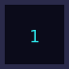</a></td><td><a href="play/-X--O----.md">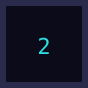</a></td><td><a href="play/--X-O----.md">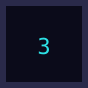</a></td></tr>
  <tr><td><a href="play/---XO----.md">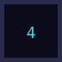</a></td><td></td><td><a href="play/----OX---.md">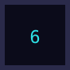</a></td></tr>
  <tr><td><a href="play/----O-X--.md">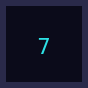</a></td><td><a href="play/----O--X-.md">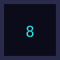</a></td><td><a href="play/----O---X.md">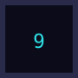</a></td></tr>
</table>

**YOUR TURN.** You are **X**. Click a numbered square. The CPU answers instantly.

<!-- TTT:END -->

## 

<b>Every square is a day of my commits, turned into a game level.</b>

  
<b>🟡 PAC-MAN</b>

  <picture>
    <source media="(prefers-color-scheme: dark)" srcset="https://raw.githubusercontent.com/apullenb/apullenb/output/pacman-contribution-graph-dark.svg" />
    
  </picture>

  
<b>🚀 GALAGA</b>

  

  
<b>🟪 TETRIS</b>

  <picture>
    <source media="(prefers-color-scheme: dark)" srcset="https://raw.githubusercontent.com/apullenb/apullenb/output/tetris-contribution-graph-dark.svg" />
    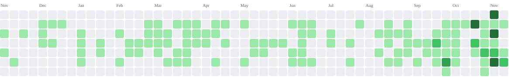
  </picture>

  
<b>🧱 BREAKOUT</b>

  <picture>
    <source media="(prefers-color-scheme: dark)" srcset="https://raw.githubusercontent.com/apullenb/apullenb/output/breakout-contribution-graph-dark.svg" />
    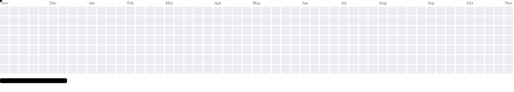
  </picture>

  
<b>⬆️ ⬆️ ⬇️ ⬇️ ⬅️ ➡️ ⬅️ ➡️ 🅱️ 🅰️</b> (secret cabinets)

   
  
<b>CHEAT CODE ACCEPTED · 3 BONUS CABINETS UNLOCKED</b>

  

    
<b>🫧 PUZZLE BOBBLE</b>

    <picture>
      <source media="(prefers-color-scheme: dark)" srcset="https://raw.githubusercontent.com/apullenb/apullenb/output/puzzle-bobble-contribution-graph-dark.svg" />
      
    </picture>
  

  

    
<b>💣 BOMBERMAN</b>

    <picture>
      <source media="(prefers-color-scheme: dark)" srcset="https://raw.githubusercontent.com/apullenb/apullenb/output/bomberman-contribution-graph-dark.svg" />
      
    </picture>
  

  

    
<b>🚩 MINESWEEPER</b>

    <picture>
      <source media="(prefers-color-scheme: dark)" srcset="https://raw.githubusercontent.com/apullenb/apullenb/output/minesweeper-contribution-graph-dark.svg" />
      
    </picture>
  

## 

| Status | Quest | Objective |
| :---: | --- | --- |
| 🟢 **ACTIVE** | **Trustworthy AI** | Ship AI features people can rely on: the model drafts, deterministic tested code checks every fact, and a person approves before anything goes out |
| 🟢 **ACTIVE** | **Modern full stack** | Next.js 16 with Cache Components, React 19, and Drizzle on serverless Postgres, deployed on Vercel |
| 🟡 **TRAINING** | **Multimodal AI** | Image generation and vision models working inside real product flows, not just demos |
| 🔵 **GRINDING XP** | **Test coverage** | Fast Vitest suites and Playwright end-to-end runs on every change |

  

