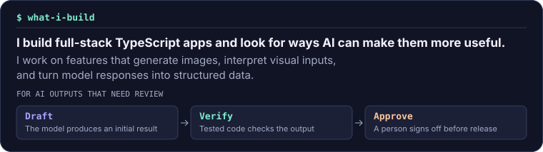
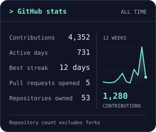
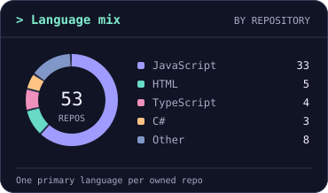

# Andrea Pullen

**Full-stack TypeScript developer**

[Portfolio repository](https://github.com/apullenb/My-Portfolio) · [LinkedIn](https://www.linkedin.com/in/andrea-pullen/)

## GitHub activity

  

[Open the contribution map](https://raw.githubusercontent.com/apullenb/apullenb/refs/heads/output/profile-contribution-detail.svg) and hover over a block for day and week totals.

<table>
  <tr>
    <td valign="top"></td>
    <td valign="top">
       
      
    </td>
  </tr>
</table>
