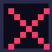
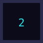

<table>
  <tr><td></td><td></td><td></td></tr>
  <tr><td></td><td></td><td></td></tr>
  <tr><td></td><td></td><td></td></tr>
</table>

**YOUR TURN.** You are **X**. The CPU played **O**. Click a numbered square.

[▶ New game](../README.md#play) · [⬅ Back to my profile](https://github.com/apullenb)

